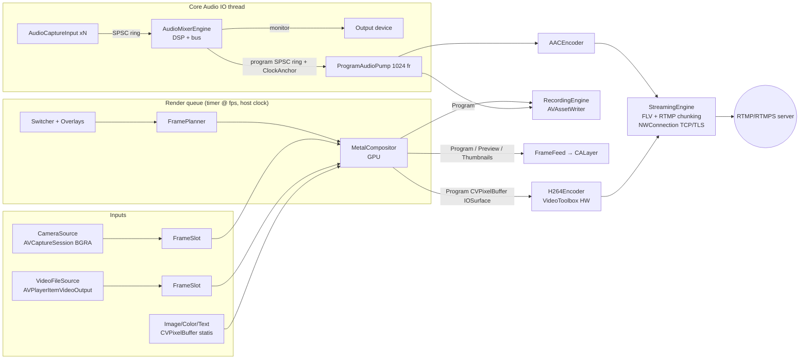

# Langkah 2 — Arsitektur LiveCore Studio

## 1. Modul dan tanggung jawab

| Modul (spesifikasi) | Implementasi | Interface utama |
|---|---|---|
| App Shell & UI Layer | `App/LiveCoreStudioApp.swift`, `Sources/LiveCoreUI/*` (SwiftUI) | `AppModel` (ObservableObject), `LiveCoreScenes` |
| Project & Session Manager | `ProductionSettings` (Codable, `LiveCoreCore/Model`) disimpan di UserDefaults; stream key di Keychain | `AppModel.apply(_:)`, `KeychainStore` |
| Input Source Manager | `ProductionEngine` (tabel input, urutan, layer scene) | `addCamera/addImage/addVideoFile/addColor/addTitle/removeInput/renameInput/moveInput` |
| Video Capture Engine | `CameraSource`, `VideoFileSource`, `ImageSource`, `ColorSource`, `TextSource` | protokol `VideoSource` (`currentFrame()`, `status`, `start/stop`) + `FrameSlot` |
| Video Compositor & Transition Engine | `MetalCompositor` + `ShaderSource` (Metal) | `render(plan:frames:thumbnailsFor:completion:)` |
| Preview/Program State Manager | `Switcher` + `FramePlanner` (LiveCoreCore, teruji) | `setPreview/cut/auto/setTBar/update/inputRemoved` → `SwitcherSnapshot`, `FramePlan` |
| Graphics & Overlay Engine | `OverlayChannel` (4 kanal, fade), `TextSource` (CoreText), `LayoutPreset` | `configureOverlay/setOverlay` |
| Audio Mixer & Routing Engine | `AudioMixerEngine`, `MixerChannel`, `ChannelStripDSP`, `Compressor`, `Limiter`, `AudioCaptureInput`, `ProgramAudioPump` | `addAudioInput`, `ChannelControls` (atomics), `setMonitorDevice` |
| Streaming Engine | `StreamingEngine` (Network.framework) + `RTMPPublishSession` (sans-IO), `StreamOutputQueue`, `H264Encoder`, `AACEncoder` | `start(url:settings:audioSpecificConfig:)`, `stop()`, `Stats` |
| Recording Engine | `RecordingEngine` (AVAssetWriter) | `start(settings:output:audio:)`, `append(video:)`, `append(audio:)`, `stop()` |
| Output Monitor | `FrameFeed`/`PixelBufferView` (IOSurface → CALayer), jendela "Program Output" untuk layar eksternal | `FrameFeed.push(_:)` |
| Device Discovery & Permissions | `DeviceManager` (DiscoverySession, hot-plug, izin), `AudioDevices` (Core Audio) | `videoDevices/audioDevices`, `requestAccess` |
| Performance Monitoring & Logging | `PerformanceMonitor` (CPU/RAM/thermal), statistik GPU per frame, `Log` (os.Logger per kategori) | `ProductionEngine.samplePerformance()` |

Paket Swift (`Package.swift`):
`CAtomics` (C11 atomics) → `LiveCoreCore` (portabel, teruji di Linux) → `LiveCoreEngine` (macOS) → `LiveCoreUI` (SwiftUI) → `LiveCoreStudio` (entry point).

## 2. Diagram



Versi teks:
```
Kamera/File/Gambar/Teks ─▶ FrameSlot ─▶ [render tick @fps] Switcher+Overlay ─▶ FramePlan ─▶ Metal
   Metal ─▶ Program buffer ─┬▶ VideoToolbox H.264 ─▶ FLV/RTMP ─▶ NWConnection ─▶ server
                            ├▶ AVAssetWriter (MP4/MOV)
                            └▶ Monitor Program (CALayer, IOSurface)
Mic/Interface ─▶ ring SPSC ─▶ Mixer (IO thread) ─┬▶ Output monitor
                                                  └▶ ring program ─▶ Pump ─┬▶ AAC ─▶ RTMP
                                                                           └▶ AVAssetWriter
```

## 3. Aliran video

1. **Capture**: `AVCaptureVideoDataOutput` mengirim `CMSampleBuffer` BGRA ke antrean capture per kamera
   (`alwaysDiscardsLateVideoFrames = true`). Hanya pointer `CVPixelBuffer` terbaru yang disimpan di `FrameSlot`
   (satu slot → pool capture tidak pernah kehabisan buffer). Format perangkat dipilih paling dekat dengan resolusi output
   yang mendukung frame rate output.
2. **Render tick**: `DispatchSourceTimer` (strict) berdetak 2× fps; indeks frame dihitung dari host clock
   (`(now - start) × fps`), sehingga jitter timer tidak menggeser timestamp. Detak yang terlambat dihitung sebagai
   *dropped render frames*. Maksimal 2 frame *in flight* di GPU (backpressure; frame ke-3 di-drop, tidak menumpuk).
3. **Rencana frame**: `Switcher.update(now)` memajukan transisi; `FramePlanner` menghasilkan daftar `DrawCommand`
   untuk Program (A), input masuk (B) saat transisi, Overlay, dan Preview.
4. **Komposisi GPU**: setiap `CVPixelBuffer` dibungkus `MTLTexture` lewat `CVMetalTextureCache` (tanpa salinan).
   Saat transisi: A → tekstur antara, B → tekstur antara, shader transisi → buffer Program; overlay digambar di atasnya.
   Scaling: `fit` (letterbox), `fill` (crop via UV, tanpa scissor), `stretch`.
5. **Fan-out**: setelah GPU selesai (completion handler), buffer Program yang sama diteruskan ke VideoToolbox
   (jika stream aktif), AVAssetWriter (jika rekam aktif), dan monitor. **Satu pipeline capture/komposisi** melayani
   semua output.

**Kebijakan pixel format**: BGRA 8-bit premultiplied, IOSurface-backed, Metal-compatible di seluruh jalur.
(Optimasi M2: capture 420v + konversi YUV di shader untuk menghemat bandwidth.)

**Kebijakan timestamp**: satu jam induk = host clock (`mach_absolute_time`, `CACurrentMediaTime`).
PTS video = `start + index/fps` (dalam host clock); PTS audio = host time sampel pertama chunk (lihat §4).
Encoder dan writer menerima PTS dalam jam yang sama → A/V sinkron. RTMP: `ms = PTS − PTS keyframe pertama setelah publish`.

**Manajemen buffer**: pool `CVPixelBufferPool` untuk Program (6), Preview setengah resolusi (4), thumbnail 256×144 (16),
dengan `kCVPixelBufferPoolAllocationThresholdKey` = 12 → jika konsumen menahan terlalu banyak buffer, frame di-drop
alih-alih alokasi tanpa batas. Monitor menahan 2 buffer terakhir agar IOSurface yang sedang tampil tidak didaur ulang.

## 4. Aliran audio

- **Format internal**: 48 kHz, Float32, stereo, non-interleaved.
- **Input**: `AVCaptureAudioDataOutput.audioSettings` meminta OS mengonversi ke format internal (resampling oleh Core Audio).
  Sampel ditulis ke dua ring SPSC lock-free per kanal (kapasitas 1 detik).
- **Mixer** (callback `AVAudioSourceNode`, thread IO Core Audio): untuk tiap kanal → jitter buffer
  (mulai baca setelah ≥1024 sampel ≈21 ms; jika >4800 sampel ≈100 ms, buang kelebihan ke 2048) → trim → compressor
  (opsional) → fader (ramp tanpa klik) → pan → meter puncak (atomic) → bus Program dan/atau bus Monitor (solo).
  Bus Program → fader master → limiter pelindung (−1 dBFS) → meter master → ring Program.
  Output perangkat = bus Monitor (jika ada solo) atau Program × volume monitor.
- **Aturan real-time**: tanpa alokasi (scratch dialokasikan di init), tanpa lock yang dapat memblokir (daftar kanal dibaca
  dengan `trylock`; bila kalah balapan dengan UI, blok itu dirender senyap), tanpa log/ObjC di callback.
- **Timestamp**: tiap blok, mixer menerbitkan pasangan (posisi tulis ring, host time) melalui `ClockAnchor` (seqlock).
  `ProgramAudioPump` menghitung host time chunk = anchorHost + (posisiBaca − anchorIndex)/48000.
  AAC: Apple AAC encoder punya delay 2112 sampel; paket ke-k diberi PTS `first + (k·1024 − 2112)/sr`.
- **Latensi**: buffer IO Core Audio (biasanya 512 sampel ≈ 10,7 ms) + jitter buffer ≈ 21–43 ms + capture. Offset A/V manual
  (−500…+500 ms) tersedia untuk mengompensasi latensi kamera.
- **Sample rate perangkat**: input dikonversi oleh AVCapture; output dikonversi oleh `mainMixerNode` AVAudioEngine.

## 5. Aliran data & kontrol, concurrency

| Thread / antrean | Isi | Komunikasi |
|---|---|---|
| Main | SwiftUI, `AppModel`, API publik `ProductionEngine` | menulis `ControlState` di bawah `Locked` (os_unfair_lock, tidak pernah ditahan lama) |
| `livecore.render` (userInteractive) | render tick, FramePlanner, encode command buffer Metal | snapshot `ControlState` sekali per frame |
| Metal completion | fan-out ke encoder/recorder, kirim ke main | |
| `livecore.camera.*` | callback capture video | `FrameSlot` (lock singkat) |
| `livecore.audio-in.*` | callback capture audio | ring SPSC lock-free |
| Core Audio IO | mixer | ring SPSC, `AtomicFloat/Bool`, `ClockAnchor` |
| `livecore.audio-pump` | chunk 1024, AAC encode, PCM ke recorder | closure sink |
| `livecore.stream` | RTMP session, antrean output, NWConnection | semua state streaming hanya di antrean ini |
| `livecore.record` | AVAssetWriter | semua state rekaman hanya di antrean ini |
| VideoToolbox internal | callback frame terenkode | `StreamingEngine.send(video:)` → antrean stream |

Pencegahan deadlock: tidak ada lock bersarang; tidak ada `sync` dari antrean real-time ke main;
`renderQueue.sync` hanya dipanggil dari main saat ganti resolusi (render tidak pernah menunggu main).

## 6. Streaming: pipeline eksplisit

AVFoundation **tidak** menyediakan RTMP. Pipeline yang diimplementasikan:
`CVPixelBuffer → VTCompressionSession (H.264, tanpa B-frame, GOP 2 s, CBR-like) → AVCC + SPS/PPS →
AVCDecoderConfigurationRecord → FLV video tag body → RTMP message → chunk (4096) → NWConnection (TLS untuk rtmps)`.
Audio: `PCM → AVAudioConverter AAC-LC → FLV audio tag (AudioSpecificConfig + raw) → RTMP`.
Handshake & perintah: C0/C1/C2, `connect`, `releaseStream`, `FCPublish`, `createStream`, `publish`, `@setDataFrame onMetaData`,
balasan Window Ack/Ping, deteksi `NetStream.Publish.Start` / error.

Backpressure: maksimal 256 KB *in flight* di socket; sisanya di `StreamOutputQueue`. Jika antrean video > 3 detik,
seluruh video antre dibuang dan pengiriman lanjut di keyframe berikutnya (encoder diminta IDR) → statistik *dropped frames*.

Reconnect: hanya setelah pernah live (URL/key salah dilaporkan, tidak di-retry). Backoff eksponensial 1 s ×2 hingga 30 s,
maks 10 percobaan, jitter 10%. Setiap reconnect: handshake baru, header konfigurasi dikirim ulang, timestamp mulai dari 0.

## 7. Keputusan desain UI (Langkah 3)

- Tata letak: Top bar (nama, format output, CPU/GPU/RAM/FPS/drop, termal, status STREAM/REC, tombol jendela output & pengaturan) →
  kiri: panel Input (thumbnail live 5 fps, nomor, status, ikon jenis, menu konteks) → tengah atas: Preview | Transisi | Program →
  bawah: Mixer audio | Panel kontrol (Overlay 1–4, Stream, Record).
- `HSplitView`/`VSplitView` agar ukuran panel dapat diubah; ukuran minimum 1180×720 (MacBook Air 13" = 1470×956 pt).
- Monitor eksternal: jendela "Program Output" dapat diseret ke layar lain dan dijadikan full screen (⌃⌘F).
- Warna: merah = Program/on-air, hijau = Preview, kuning = peringatan.
- Pintasan (dapat diubah di Settings): Space = CUT, Return = AUTO, 1–9 = Preview input, ⌘L = stream, ⌘R = rekam.
  Klik tile = Preview, klik ganda = Cut langsung.
- Kontrol yang belum diimplementasikan **tidak ditampilkan** (mis. chroma key, NDI, audio file video).
- Lokalisasi: `Localizable.strings` en + id (bahasa mengikuti preferensi macOS per aplikasi).
